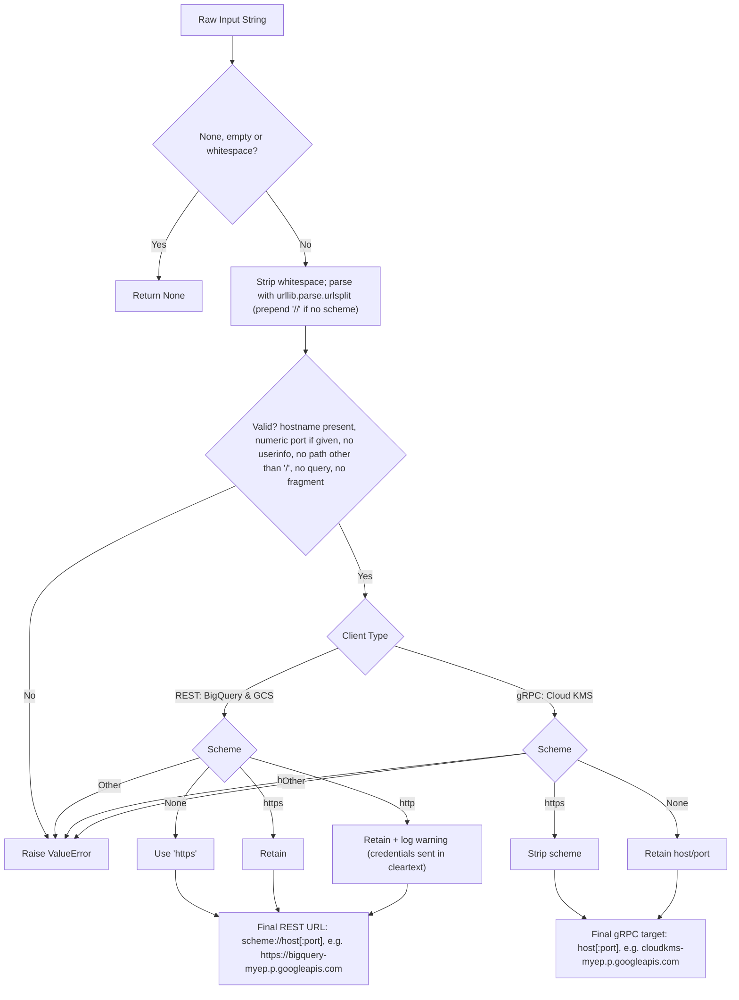
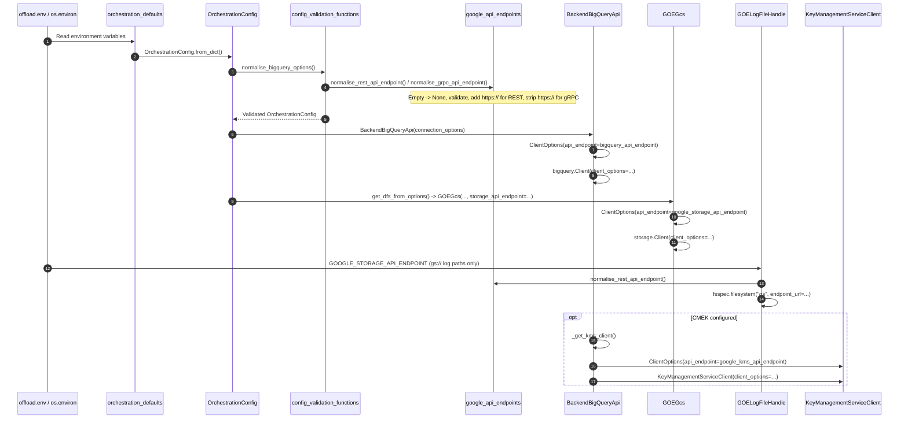

# Design Document: Custom Google APIs Endpoints for BigQuery, Cloud Storage, and Cloud KMS

## 1. Executive Summary & Motivation

### 1.1. Context & Problem Statement
In enterprise customer deployments with strict network boundaries (such as Private Service Connect (PSC) or restricted outbound corporate proxies/firewalls), egress to default public Google API domains (`*.googleapis.com`) is blocked.

Customers must route traffic to private endpoints, for example:
* Private Service Connect for Google APIs endpoints, which take the form `SERVICE-ENDPOINTNAME.p.googleapis.com` (e.g. `bigquery-myep.p.googleapis.com`, `storage-myep.p.googleapis.com`, `cloudkms-myep.p.googleapis.com`).
* Customer internal DNS names or reverse proxies (e.g. `https://bigquery-psc.internal.company.com`).

> Note: Private Google Access via the `private.googleapis.com` / `restricted.googleapis.com` VIPs is normally implemented with DNS overrides of the default `*.googleapis.com` hostnames and does **not** require any endpoint override in GOE.

While Google Cloud client libraries for Python support custom endpoints via `google.api_core.client_options.ClientOptions(api_endpoint=...)`, the Gluent Offload Engine (GOE) does not currently provide configuration settings to pass custom endpoints to the Google Cloud clients. As a result, connection attempts fail in these environments.

This work addresses [GitHub Issue #239](https://github.com/gluent/goe/issues/239) and covers the three Google Cloud services accessed by GOE via Python client libraries when targeting Google BigQuery:
1. **Google BigQuery** (orchestration query engine and metadata repository)
2. **Google Cloud Storage (GCS)** (data staging and log storage)
3. **Google Cloud Key Management Service (Cloud KMS)** (customer-managed encryption keys / CMEK)

A review of `src/` confirms these are the only Google client construction sites:

| Client | Location |
| :--- | :--- |
| `bigquery.Client` | `BackendBigQueryApi._get_bq_client()` in `src/goe/offload/bigquery/bigquery_backend_api.py` |
| `kms.KeyManagementServiceClient` | `BackendBigQueryApi._get_kms_client()` in `src/goe/offload/bigquery/bigquery_backend_api.py` |
| `storage.Client` | `GOEGcs.__init__()` in `src/goe/filesystem/goe_gcs.py` |
| `fsspec.filesystem("gs")` (gcsfs) | `GOELogFileHandle._get_fs()` in `src/goe/util/goe_log_fh.py` |

The BigQuery Storage Read API (`bigquerystorage.googleapis.com`) is not used by GOE (no `to_dataframe()`/`to_arrow()`/`bigquery_storage` usage), therefore no fourth endpoint is required.

### 1.2. Key Objectives
* Provide configuration variables in `offload.env` for BigQuery, Cloud Storage, and Cloud KMS endpoints.
* Allow users to supply endpoints with or without scheme (e.g. `bigquery-myep.p.googleapis.com` or `https://bigquery-myep.p.googleapis.com`).
* Automatically normalize and validate endpoints according to the underlying client protocol requirements (HTTP/REST vs gRPC).
* Ensure full backward compatibility: if not specified (unset or empty), clients default to standard Google public endpoints and are constructed exactly as today.
* Integrate with GOE configuration validation and the `connect` verification utility.

### 1.3. Out of Scope
* **Google Managed Spark (Dataproc) via `gcloud`**: The Spark Batches/Dataproc offload transports invoke `gcloud dataproc ...` from the GOE host (`src/goe/offload/spark/dataproc_offload_transport.py`), which calls `dataproc.googleapis.com`. This is not covered by a new GOE setting. `gcloud` natively supports endpoint overrides which customers can use instead, for example:
  * Environment variable: `CLOUDSDK_API_ENDPOINT_OVERRIDES_DATAPROC=https://dataproc-myep.p.googleapis.com/`. This can be set in `offload.env` because `config_file.load_env()` loads it into `os.environ` and `run_os_cmd()` launches `gcloud` via `subprocess.Popen` inheriting the environment.
  * Or `gcloud config set api_endpoint_overrides/dataproc https://dataproc-myep.p.googleapis.com/`.

  `gcloud` constraints (verified):
  * The value **must** be an absolute `http://`/`https://` URI **ending with a trailing `/`**; otherwise `gcloud` rejects it.
  * An **empty** value (`CLOUDSDK_API_ENDPOINT_OVERRIDES_DATAPROC=`) is **not** treated as unset: every `gcloud dataproc` command fails with `Invalid value for property [api_endpoint_overrides/dataproc] ... [] is not a valid endpoint override.`

  Because of the empty-value behaviour, this workaround is surfaced in the template as a non-key comment using the `export` form (see section 2.3) and in user documentation (section 5.9). A first-class GOE setting (e.g. `GOOGLE_DATAPROC_API_ENDPOINT`, normalized and passed to `gcloud` via a subprocess `env=`) is a possible follow-up.
* **Traffic originating from Dataproc workers** (e.g. Spark reading/writing staged files in GCS) runs inside the customer VPC and is governed by Dataproc/VPC configuration (e.g. Private Google Access), not by GOE.

---

## 2. Configuration Specifications

### 2.1. Environment Variables in `offload.env.template.bigquery`

Three new optional configuration variables will be introduced in `templates/conf/offload.env.template.bigquery`:

| Environment Variable | Config Attribute | Target Client | Default | Description & Examples |
| :--- | :--- | :--- | :--- | :--- |
| `BIGQUERY_API_ENDPOINT` | `bigquery_api_endpoint` | `bigquery.Client` | `None` (public endpoint) | Custom API endpoint for Google BigQuery.<br/>Examples: `bigquery-myep.p.googleapis.com`, `https://bigquery-myep.p.googleapis.com`, `https://my-bq-proxy.internal.corp:8443` |
| `GOOGLE_STORAGE_API_ENDPOINT` | `google_storage_api_endpoint` | `storage.Client` & `fsspec`/`gcsfs` | `None` (public endpoint) | Custom API endpoint for Google Cloud Storage.<br/>Examples: `storage-myep.p.googleapis.com`, `https://storage-myep.p.googleapis.com`, `https://my-gcs-proxy.internal.corp:8443` |
| `GOOGLE_KMS_API_ENDPOINT` | `google_kms_api_endpoint` | `kms.KeyManagementServiceClient` | `None` (public endpoint) | Custom API endpoint for Google Cloud KMS (CMEK).<br/>Examples: `cloudkms-myep.p.googleapis.com`, `cloudkms-myep.p.googleapis.com:443`, `https://cloudkms-myep.p.googleapis.com` |

An empty value (e.g. `BIGQUERY_API_ENDPOINT=`) is treated identically to the variable being unset.

> Note on KMS impact: BigQuery applies CMEK server-side using the key name; GOE's KMS client is only used for key path formatting (local, no network call) and for the key validation check in `connect` (`check_backend_supporting_objects()` → `get_crypto_key()`). Therefore `GOOGLE_KMS_API_ENDPOINT` only affects `connect`. An unreachable KMS endpoint does not affect Offload/Present operations. This will be stated in the template comments and user documentation.

### 2.2. Placement in Template
In `templates/conf/offload.env.template.bigquery`, following the existing convention for GCP settings, the variables are added uncommented with empty values (`VAR=`). `connect` detects template keys whether commented or not (`KEY_VALUE_PATTERN = r"#?[ ]*([A-Z_0-9]+)=(.*)"`), and `connect --upgrade-environment-file` appends missing keys as `KEY=`; empty values are handled as "unset" (see section 3).

* `BIGQUERY_API_ENDPOINT` placed in the **Google BigQuery settings** section directly following `BIGQUERY_DATASET_PROJECT`.
* `GOOGLE_KMS_API_ENDPOINT` placed in the **Google BigQuery settings** section, within the Cloud KMS block, directly following `GOOGLE_KMS_KEY_NAME`.
* `GOOGLE_STORAGE_API_ENDPOINT` placed in the **Filesystem type for Offloaded tables** section following `OFFLOAD_FS_CONTAINER`.

Template comments must use the correct PSC hostname form (`SERVICE-ENDPOINTNAME.p.googleapis.com`) in examples.

### 2.3. `gcloud` Dataproc Endpoint Guidance in Template
A commented guidance block for `CLOUDSDK_API_ENDPOINT_OVERRIDES_DATAPROC` is added to the **Google BigQuery settings** section, directly following `GOOGLE_DATAPROC_BATCHES_TTL`:

```bash
# Google Managed Spark API endpoint override for gcloud (e.g. Private Service Connect).
# This is a native gcloud setting, not a GOE setting. The value must start with https:// and END WITH A TRAILING '/'.
# Do not set it to an empty value; gcloud rejects empty values and all Managed Spark commands will fail.
# export CLOUDSDK_API_ENDPOINT_OVERRIDES_DATAPROC=https://dataproc-myep.p.googleapis.com/
```

The entry deliberately uses the `export` form rather than `# CLOUDSDK_API_ENDPOINT_OVERRIDES_DATAPROC=`:
* `connect` treats commented `# KEY=` lines as template keys (`KEY_VALUE_PATTERN = r"#?[ ]*([A-Z_0-9]+)=(.*)"`). A `# KEY=` entry would cause `connect` to report the key as missing from `offload.env` and `connect --upgrade-environment-file` to append `CLOUDSDK_API_ENDPOINT_OVERRIDES_DATAPROC=` (empty), which breaks all `gcloud dataproc` commands (section 1.3).
* `# export CLOUDSDK_...=...` does not match `KEY_VALUE_PATTERN` (verified), so it is never reported or appended by `connect`.
* `python-dotenv` supports the `export` prefix (verified), so a user can simply uncomment the line. The uncommented `export ...` line also does not match `KEY_VALUE_PATTERN`, so `connect` does not report it as "present in offload.env but not in template". (If a user writes it without `export`, `connect` will emit a harmless "not in template" warning.)

---

## 3. Endpoint Normalization & Validation Rules

### 3.1. User Experience Requirement
Users should not need to remember whether a particular Google client uses HTTP REST (requiring `https://`) or gRPC (requiring `host:port`). GOE will accept hostnames in either format and normalize them.

### 3.2. Normalization Rules



#### Common Rules (all endpoints)
* `None`, an empty string, or a whitespace-only string normalizes to `None` (use the library default public endpoint).
* Leading/trailing whitespace is stripped.
* The value is parsed with `urllib.parse.urlsplit()`. If no scheme is present, `"//"` is prepended before parsing so that the host and port are parsed correctly.
* The following are rejected as malformed:
  * Missing hostname.
  * Non-numeric or out-of-range port.
  * Userinfo (e.g. `user:pass@host`).
  * Any path component other than a single trailing `/` (e.g. `https://host/bigquery/v2` is rejected because the client libraries append their own API paths; `gcsfs` explicitly requires an endpoint without a path).
  * Query string or fragment.
* Normalization helpers raise `ValueError`; the config layer wraps this in `exc_cls` (default `OrchestrationConfigException`) with a message naming the offending variable, e.g. `Invalid value for BIGQUERY_API_ENDPOINT: ...`.

#### REST Clients (`BIGQUERY_API_ENDPOINT`, `GOOGLE_STORAGE_API_ENDPOINT`)
* Underlying clients: `google.cloud.bigquery.Client`, `google.cloud.storage.Client`, and `gcsfs.GCSFileSystem` use HTTP/HTTPS.
* Output form: `scheme://host[:port]` with no trailing slash.
* If no scheme is present (e.g. `bigquery-myep.p.googleapis.com`), use `https` → `https://bigquery-myep.p.googleapis.com`.
* If explicit `https://` is supplied, preserve it.
* If explicit `http://` is supplied, preserve it (useful for emulators/testing) but log a warning that OAuth credentials will be sent in cleartext.
* Any other scheme raises.

#### gRPC Clients (`GOOGLE_KMS_API_ENDPOINT`)
* Underlying client: `google.cloud.kms.KeyManagementServiceClient` uses gRPC over a secure (TLS) channel.
* gRPC target addresses must be formatted as `host` or `host:port` without URL schemes. Verified: passing `https://host` to the KMS client results in a broken gRPC target, hence scheme stripping is required.
* If `https://` is supplied (e.g. `https://cloudkms-myep.p.googleapis.com`), strip the scheme → `cloudkms-myep.p.googleapis.com`.
* If `http://` is supplied, raise: the GAPIC gRPC transport always uses TLS, so silently stripping `http://` would change the user's stated intent.
* Any other scheme raises.
* If no port is specified, the GAPIC transport automatically defaults to `:443`. If a port is explicitly included (e.g. `cloudkms-myep.p.googleapis.com:8443`), retain it.

### 3.3. Location of Normalization Helpers
The helpers live in a new leaf module, `src/goe/util/google_api_endpoints.py`, which must not import from `goe.config` (or any module that does). This is required because:
* `src/goe/util/goe_log_fh.py` needs the REST normalizer for GCS log files, and
* `src/goe/config/config_validation_functions.py` already imports `goe.util.goe_log_fh`, so placing the helpers in `config_validation_functions` would create a circular import.

---

## 4. Architecture & Component Flow



---

## 5. Detailed File Changes

### 5.1. Configuration Template
* **File**: `templates/conf/offload.env.template.bigquery`
  * Add `BIGQUERY_API_ENDPOINT=` with explanatory comments (placement per section 2.2).
  * Add `GOOGLE_KMS_API_ENDPOINT=` with explanatory comments, including that it only affects `connect` key validation.
  * Add `GOOGLE_STORAGE_API_ENDPOINT=` with explanatory comments, including that it also applies to `gs://` log locations (`OFFLOAD_LOGDIR`).
  * Comments must use correct PSC example hostnames (`SERVICE-ENDPOINTNAME.p.googleapis.com`).
  * Add the commented `# export CLOUDSDK_API_ENDPOINT_OVERRIDES_DATAPROC=...` guidance block after `GOOGLE_DATAPROC_BATCHES_TTL` exactly as specified in section 2.3 (must use the `export` form; must not be a `# KEY=` line).
* **Build Artifact**:
  * Running `make install` in `templates/conf/` regenerates:
    * `target/offload/conf/oracle-bigquery-offload.env.template`
    * `target/offload/conf/teradata-bigquery-offload.env.template`

### 5.2. Endpoint Normalization Helpers (new)
* **File**: `src/goe/util/google_api_endpoints.py` (new leaf module, no `goe.config` imports)
  ```python
  def normalise_rest_api_endpoint(endpoint: Optional[str]) -> Optional[str]:
      """Normalize an HTTP/REST endpoint to scheme://host[:port].

      Returns None for None/empty/whitespace. Defaults scheme to https.
      Logs a warning for http. Raises ValueError for malformed input or
      unsupported schemes (see design section 3.2).
      """
      ...

  def normalise_grpc_api_endpoint(endpoint: Optional[str]) -> Optional[str]:
      """Normalize a gRPC endpoint to host[:port].

      Returns None for None/empty/whitespace. Strips https://.
      Raises ValueError for http://, other schemes, or malformed input.
      """
      ...
  ```

### 5.3. Defaults Management
* **File**: `src/goe/config/orchestration_defaults.py`
  * Add default resolver functions:
    ```python
    def bigquery_api_endpoint_default() -> Optional[str]:
        return os.environ.get("BIGQUERY_API_ENDPOINT")

    def google_storage_api_endpoint_default() -> Optional[str]:
        return os.environ.get("GOOGLE_STORAGE_API_ENDPOINT")

    def google_kms_api_endpoint_default() -> Optional[str]:
        return os.environ.get("GOOGLE_KMS_API_ENDPOINT")
    ```

### 5.4. Orchestration Config Dataclass
* **File**: `src/goe/config/orchestration_config.py`
  * Add to `EXPECTED_CONFIG_ARGS`:
    * `"bigquery_api_endpoint"`
    * `"google_storage_api_endpoint"`
    * `"google_kms_api_endpoint"`
  * Add dataclass attributes:
    ```python
    bigquery_api_endpoint: Optional[str]
    google_storage_api_endpoint: Optional[str]
    google_kms_api_endpoint: Optional[str]
    ```
  * In `OrchestrationConfig.from_dict()`:
    Map each new field from `config_dict` using the corresponding `orchestration_defaults` function.

### 5.5. Validation & Normalization
* **File**: `src/goe/config/config_validation_functions.py`
  * Import helpers from `goe.util.google_api_endpoints`.
  * In `normalise_bigquery_options(options, exc_cls)` (only runs for `BACKEND_DISTRO_GCP`):
    * Apply `normalise_rest_api_endpoint` to `options.bigquery_api_endpoint` and `options.google_storage_api_endpoint`.
    * Apply `normalise_grpc_api_endpoint` to `options.google_kms_api_endpoint`.
    * Catch `ValueError` and re-raise as `exc_cls(f"Invalid value for <ENV_VAR_NAME>: {value}: {error}")`.

### 5.6. BigQuery & KMS Client Setup
* **File**: `src/goe/offload/bigquery/bigquery_backend_api.py`
  * In `BackendBigQueryApi.__init__`:
    * Store `self._bigquery_api_endpoint = connection_options.bigquery_api_endpoint or None`
    * Store `self._google_kms_api_endpoint = connection_options.google_kms_api_endpoint or None`
  * In `BackendBigQueryApi._get_bq_client()`:
    * Construct `ClientOptions(api_endpoint=self._bigquery_api_endpoint)` only when an endpoint is provided.
    * Pass `client_options=client_options` to `bigquery.Client(...)` only when set, so the default code path is unchanged.
  * In `BackendBigQueryApi._get_kms_client()`:
    * Construct `ClientOptions(api_endpoint=self._google_kms_api_endpoint)` only when an endpoint is provided.
    * Pass `client_options=client_options` to `kms.KeyManagementServiceClient(...)` only when set.

### 5.7. GCS Staging & Logging Clients
* **File**: `src/goe/filesystem/goe_gcs.py`
  * In `GOEGcs.__init__`:
    * Accept `storage_api_endpoint: Optional[str] = None` (defaulted, so existing direct constructions remain valid).
    * When constructing `self._client = storage.Client(...)`, pass `client_options=ClientOptions(api_endpoint=storage_api_endpoint)` only if set.
* **File**: `src/goe/filesystem/goe_dfs_factory.py`
  * When instantiating `GOEGcs`, pass `storage_api_endpoint=config.google_storage_api_endpoint`.
* **File**: `src/goe/util/goe_log_fh.py`
  * In `_get_fs()`, for `gs://` paths only:
    * Read `GOOGLE_STORAGE_API_ENDPOINT` from the environment. Callers such as `OffloadMessages.init_log()` and the CLI `init_log()` functions do not have access to `OrchestrationConfig`, and some entry points (e.g. `offload_by_cli()`, `offload_status_report_run()`) initialise logging before `OrchestrationConfig.from_dict()` is called. The `gs://` log path itself is derived from `OFFLOAD_LOGDIR` in the same environment (loaded by `config_file.load_env()` in the CLI wrappers, or exported by the user's shell), so `GOOGLE_STORAGE_API_ENDPOINT` is available whenever a `gs://` log path is.
    * Normalize via `goe.util.google_api_endpoints.normalise_rest_api_endpoint()` — the raw value must **not** be passed directly because `gcsfs` requires `scheme://host[:port]` without a path. Because log initialisation can precede config validation, re-raise any `ValueError` with a message naming `GOOGLE_STORAGE_API_ENDPOINT` so the user gets a clear error.
    * If the normalized value is not `None`, pass `endpoint_url=<normalized>` to `fsspec.filesystem("gs", ...)`; otherwise call as today.

### 5.8. Environment Verification Tool (`connect`)
`connect` already exercises all three endpoints:
* BigQuery: `test_backend_db_connectivity()` in `src/goe/connect/connect_backend.py`.
* Cloud KMS: `run_check_backend_supporting_objects()` → `BackendBigQueryApi.check_backend_supporting_objects()` → `get_crypto_key()`.
* GCS: `test_offload_fs_container()` in `src/goe/connect/connect.py`.

Changes are therefore limited to reporting which endpoints are in use:
* **File**: `src/goe/connect/connect_backend.py`
  * In `run_backend_tests()`:
    * When `orchestration_config.bigquery_api_endpoint` is set, log `detail("Using custom BigQuery API endpoint: %s" % orchestration_config.bigquery_api_endpoint)`.
    * When `orchestration_config.google_kms_api_endpoint` is set, log the corresponding KMS message.
* **File**: `src/goe/connect/connect.py`
  * In `test_offload_fs_container()`:
    * When `orchestration_config.google_storage_api_endpoint` is set, log `detail("Using custom Cloud Storage API endpoint: %s" % ...)`.

### 5.9. User Documentation
* **File**: `docs/gcp_setup.md` (or `docs/user_guide.md`)
  * Add a "Private / custom Google API endpoints" section describing the three variables, accepted formats, the KMS impact note, and the out-of-scope `gcloud` Dataproc workaround (`CLOUDSDK_API_ENDPOINT_OVERRIDES_DATAPROC`), including the trailing-`/` requirement, the warning never to set it to an empty value, and the recommended `export` form in `offload.env`.

---

## 6. Testing Strategy

### 6.1. Unit Tests
1. **Endpoint Helper Tests** (`tests/unit/util/test_google_api_endpoints.py`, new):
   * Parameterized tests for `normalise_rest_api_endpoint`:
     * `None`, `""`, `"   "` → `None`
     * Host without scheme: `bigquery-myep.p.googleapis.com` → `https://bigquery-myep.p.googleapis.com`
     * Surrounding whitespace: `"  bigquery-myep.p.googleapis.com  "` → `https://bigquery-myep.p.googleapis.com`
     * Host with trailing slash: `bigquery-myep.p.googleapis.com/` → `https://bigquery-myep.p.googleapis.com`
     * Host with explicit `https://`: `https://bigquery-myep.p.googleapis.com` → unchanged
     * Host with explicit `http://`: `http://localhost:9050` → unchanged, warning logged
     * Host with port: `bigquery-myep.p.googleapis.com:8443` → `https://bigquery-myep.p.googleapis.com:8443`
     * Raise `ValueError`: `ftp://host`, `grpc://host`, `https://host/bigquery/v2`, `https://host?x=1`, `https://host#frag`, `https://user:pw@host`, `https://host:abc`, `https://`, `://host`
   * Parameterized tests for `normalise_grpc_api_endpoint`:
     * `None`, `""`, `"   "` → `None`
     * Host with `https://`: `https://cloudkms-myep.p.googleapis.com` → `cloudkms-myep.p.googleapis.com`
     * Host with `https://` and port: `https://cloudkms-myep.p.googleapis.com:8443` → `cloudkms-myep.p.googleapis.com:8443`
     * Host without scheme: `cloudkms-myep.p.googleapis.com` → unchanged
     * Trailing slash: `cloudkms-myep.p.googleapis.com/` → `cloudkms-myep.p.googleapis.com`
     * Raise `ValueError`: `http://cloudkms-myep.p.googleapis.com`, `grpc://host`, `host/path`, `host:abc`
2. **Config & Defaults Tests** (`tests/unit/config/test_orchestration_config.py`):
   * Verify all 3 new attributes are in `EXPECTED_CONFIG_ARGS` and reflected on `OrchestrationConfig` (covered by existing `test_as_defaults`/`test_from_dict` once `FAKE_ORACLE_BQ_ENV` is updated).
   * Test `OrchestrationConfig.from_dict()` with mock values and verify normalized output.
   * Test that empty-string env values (`BIGQUERY_API_ENDPOINT=""`) result in `None` attributes.
3. **Validation Wrapper Tests** (`tests/unit/config/test_config_validation_functions.py`):
   * Verify `normalise_bigquery_options` raises `OrchestrationConfigException` with the variable name in the message for invalid input.
   * Verify endpoints are left untouched for non-GCP backend distributions.
4. **Backend API Client Tests** (`tests/unit/offload/test_backend_api.py`):
   * Unit tests construct the API with `do_not_connect=True`, so call `_get_bq_client()` / `_get_kms_client()` directly with `bigquery.Client` / `kms.KeyManagementServiceClient` patched.
   * Verify `client_options.api_endpoint` receives the configured BigQuery and KMS endpoints.
   * Backward compatibility: with no endpoint configured, verify `client_options` is not passed.
5. **GCS Filesystem Tests** (`tests/unit/filesystem/test_goe_dfs.py`):
   * Patch `storage.Client` and verify `GOEGcs` passes `client_options` with the custom endpoint when set and does not pass it when unset.
   * Verify `get_dfs_from_options()` forwards `config.google_storage_api_endpoint` to `GOEGcs`.
6. **Log File Handle Tests** (`tests/unit/util/test_goe_log_fh.py`, new):
   * Patch `fsspec.filesystem` and verify `endpoint_url` is passed (normalized, e.g. scheme-less input becomes `https://...`) for `gs://` paths when `GOOGLE_STORAGE_API_ENDPOINT` is set.
   * Verify `endpoint_url` is not passed when unset/empty, and never for local paths.
7. **Mock Environment Updates** (`tests/unit/test_functions.py`):
   * Update `FAKE_ORACLE_BQ_ENV` to include sample values for the new variables.
8. **Template Guard Test** (`tests/unit/connect/test_connect.py`):
   * Parse `templates/conf/offload.env.template.bigquery` with `connect.dict_from_environment_file()` and assert `BIGQUERY_API_ENDPOINT`, `GOOGLE_STORAGE_API_ENDPOINT` and `GOOGLE_KMS_API_ENDPOINT` are present, and `CLOUDSDK_API_ENDPOINT_OVERRIDES_DATAPROC` is **absent**. This stops a future edit from turning the guidance into a `# KEY=` line that `--upgrade-environment-file` would append empty.

### 6.2. Regression & Verification
* Run the complete unit test suite: `pytest tests/unit/`.
* Test `connect --upgrade-environment-file` against a sample `offload.env` lacking the new variables: verify they are appended as `KEY=` and that the resulting empty values are treated as unset (default public endpoints). Also verify `CLOUDSDK_API_ENDPOINT_OVERRIDES_DATAPROC` is **not** reported as missing by `connect` and is **not** appended by `--upgrade-environment-file`.
* Manual verification (where an environment is available): run `connect` with PSC endpoints configured and confirm BigQuery connectivity, KMS key check, and offload filesystem container checks pass, and that custom endpoint details are logged.
